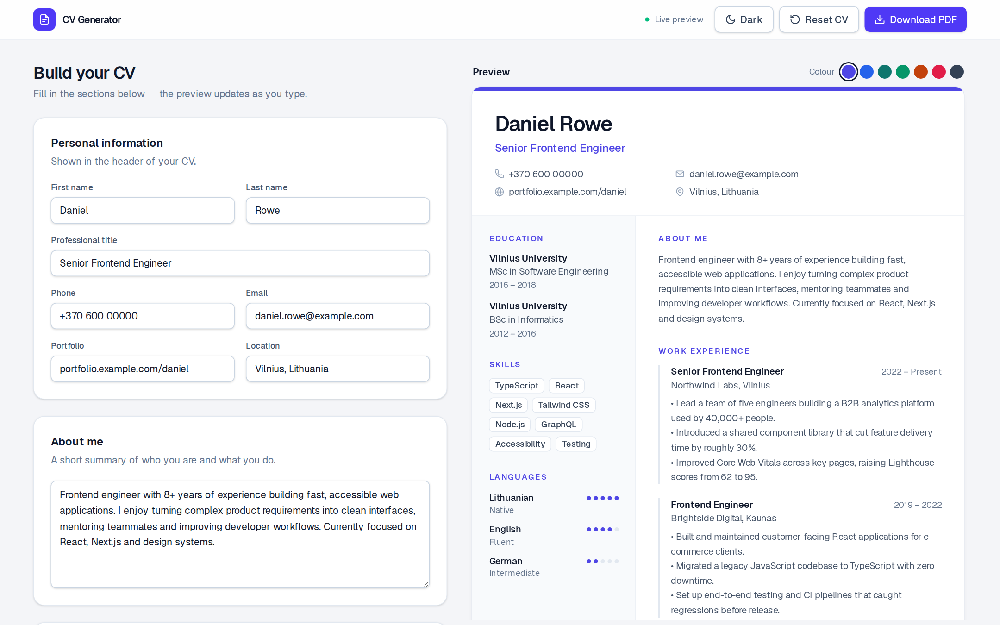
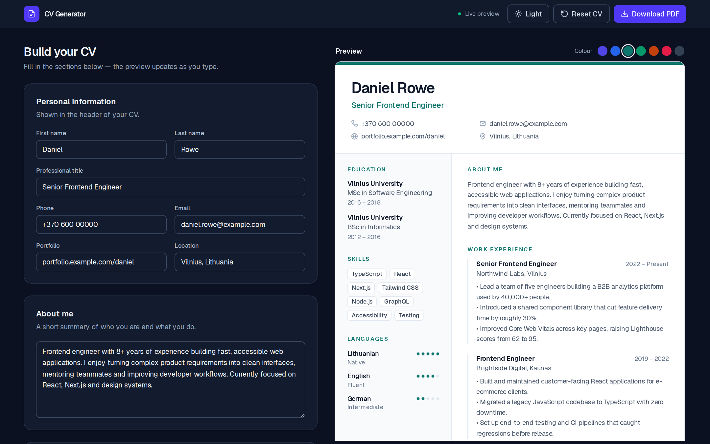

<div align="center">

# CV Generator

**Build a clean, professional CV with a live preview and download it as a real, text-selectable PDF.**

[](https://nextjs.org)
[](https://react.dev)
[](https://www.typescriptlang.org)
[](https://tailwindcss.com)



</div>

## Overview

CV Generator is a privacy-friendly CV builder that runs entirely in your browser. Fill in the form on the left, watch the CV update on the right, and export an A4 PDF in one click. There is no backend, no account and no tracking: your data never leaves your device.

## Features

- **Live preview** – the CV updates as you type.
- **Real PDF export** – vector A4 output with selectable text and embedded fonts (not a screenshot of the page), generated client-side with [`@react-pdf/renderer`](https://react-pdf.org).
- **Colour themes** – pick an accent colour (Indigo, Blue, Teal, Emerald, Orange, Rose, Graphite); it is applied to both the preview and the PDF.
- **Dark mode** – a light/dark toggle for the editor. It follows your OS setting by default and remembers your choice. The CV itself and the PDF always stay light, so what you see is what you print.
- **Flexible work history** – insert a position at any point in the list, and reorder entries with up/down arrows. Education works the same way.
- **Auto-save** – everything is stored in `localStorage` and restored on your next visit.
- **Unicode-ready** – the embedded Geist font covers Latin Extended, so names like *Žemaitė* or *Šiaulėnas* render correctly.
- **Accessible UI** – labelled controls, keyboard-friendly dialogs and visible focus states.
- **Lightweight** – the PDF library is loaded lazily, only when it is needed.

<details>
<summary><strong>Dark mode screenshot</strong></summary>
<br />

</details>

## Tech stack

| Area | Choice |
| --- | --- |
| Framework | [Next.js 16](https://nextjs.org) (App Router) |
| UI | [React 19](https://react.dev), [Tailwind CSS 4](https://tailwindcss.com) |
| Language | [TypeScript](https://www.typescriptlang.org) |
| PDF | [`@react-pdf/renderer`](https://react-pdf.org) |
| Font | [Geist](https://vercel.com/font) (SIL OFL) |
| Storage | Browser `localStorage` (no server) |

## Getting started

**Prerequisites:** Node.js 20 or newer.

```bash
# 1. Clone the repository
git clone https://github.com/<your-username>/cv-generator.git
cd cv-generator

# 2. Install dependencies
npm install

# 3. Start the development server
npm run dev
```

Open [http://localhost:3000](http://localhost:3000) in your browser.

### Scripts

| Command | Description |
| --- | --- |
| `npm run dev` | Start the development server |
| `npm run build` | Create an optimised production build |
| `npm run start` | Serve the production build |
| `npm run lint` | Run ESLint |

## Project structure

```
app/                  Next.js App Router entry (layout, page, global styles)
components/
  editor/             Form sections (personal info, about, experience, ...)
  preview/            On-screen CV preview
  ui/                 Reusable primitives (Button, TextField, EntryCard, ...)
hooks/                usePersistedCv, usePersistedTheme, useColorMode
lib/
  pdf/                PDF document, font registration and generator
  cv-themes.ts        Accent colour definitions
  cv-storage.ts       Validated localStorage read/write
  cv-helpers.ts       List helpers (insert, move, remove, ...)
types/                Shared TypeScript types
public/fonts/         Geist font files embedded in the PDF
```

## How it works

- **Single source of truth.** The CV is one `CvData` object. The editor edits it, the preview renders it, and the PDF document is built from it.
- **Safe persistence.** Data read back from `localStorage` is validated and sanitised before use, so corrupted or outdated saves can't break the app.
- **Matching preview and PDF.** The PDF layout mirrors the on-screen preview (same sizes, spacing and colours), so the downloaded file looks like what you saw.
- **Lazy PDF engine.** The PDF generator is loaded with a dynamic `import()` on hover/click of *Download PDF*, keeping it out of the initial bundle.

## Customisation

- **Add or change colour themes** – edit the list in [`lib/cv-themes.ts`](lib/cv-themes.ts). The swatches, preview and PDF update automatically.
- **Change the PDF layout** – see [`lib/pdf/cv-document.tsx`](lib/pdf/cv-document.tsx).
- **Change the sample data** – edit [`lib/sample-cv.ts`](lib/sample-cv.ts).

## Privacy

All processing happens locally in your browser. Nothing is uploaded, and the only data stored is your CV and your appearance preferences in `localStorage`. Use the **Reset CV** button to erase it.

## Deployment

The app is a standard Next.js project and deploys to [Vercel](https://vercel.com/new) with no configuration. Any host that supports Node.js works as well (`npm run build && npm run start`).

## Acknowledgements

- [Geist](https://vercel.com/font) font by Vercel, licensed under the SIL Open Font License (see [`public/fonts/OFL-Geist.txt`](public/fonts/OFL-Geist.txt)).
- [React PDF](https://react-pdf.org) for PDF rendering.
